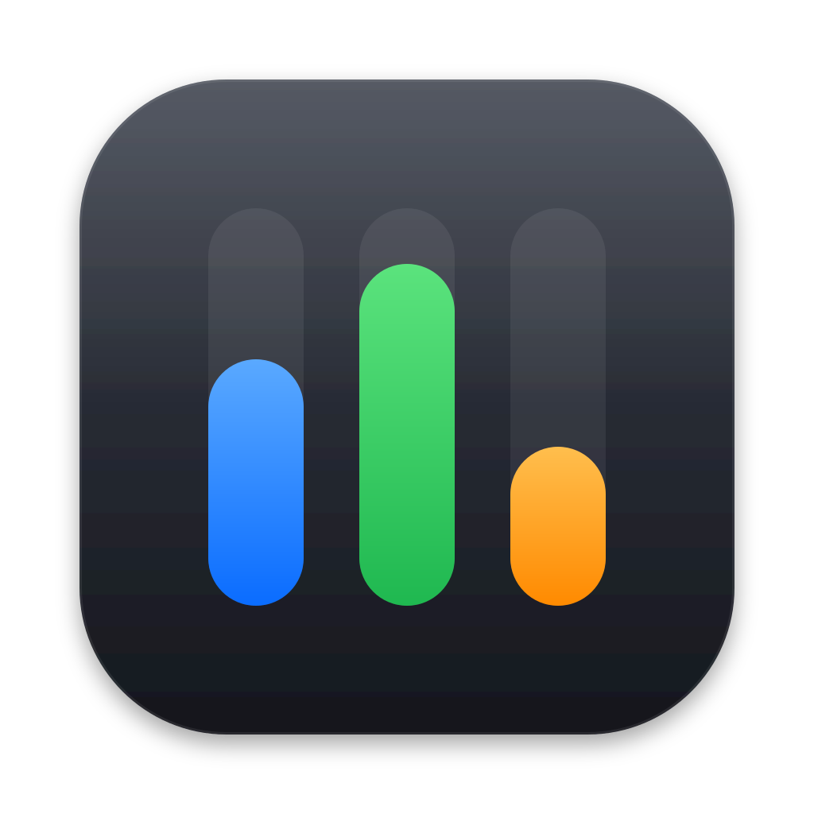
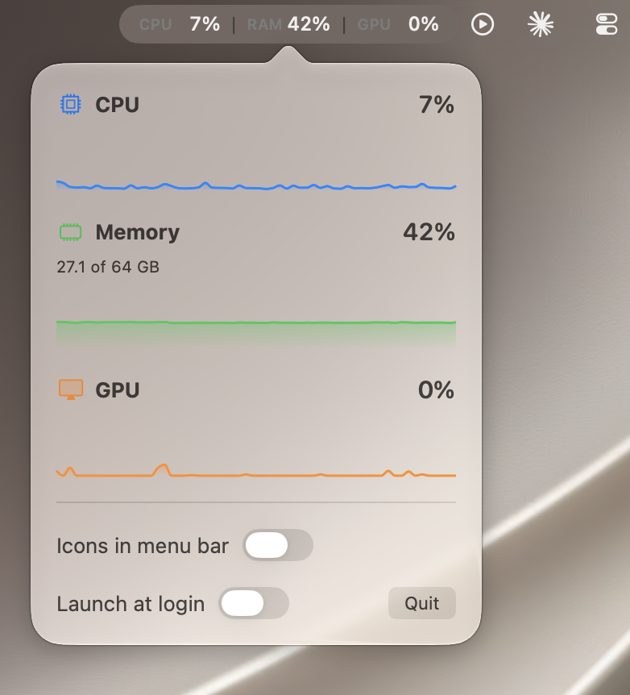
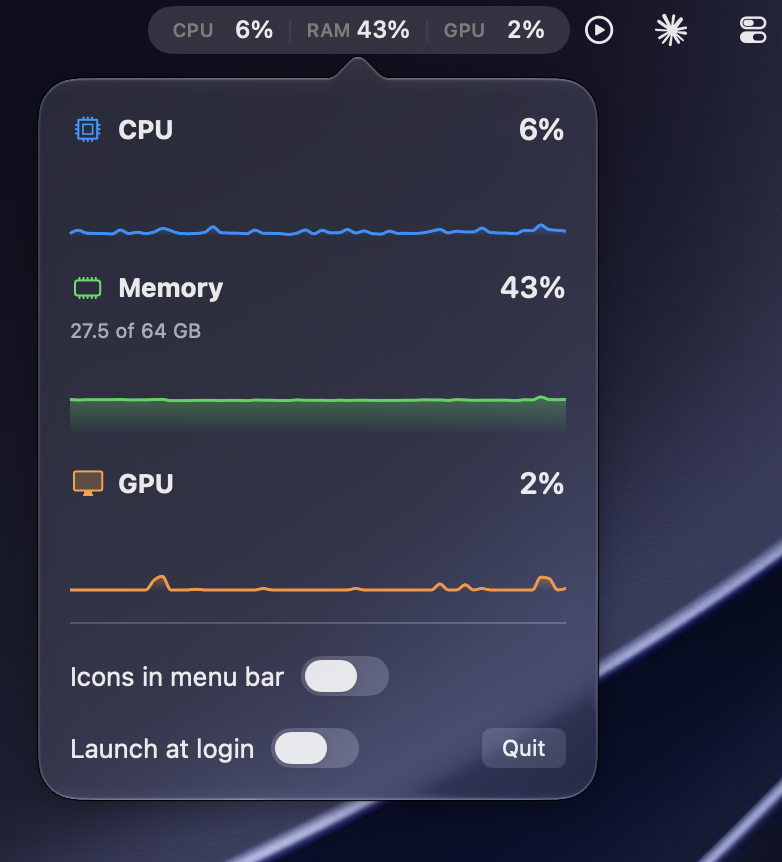
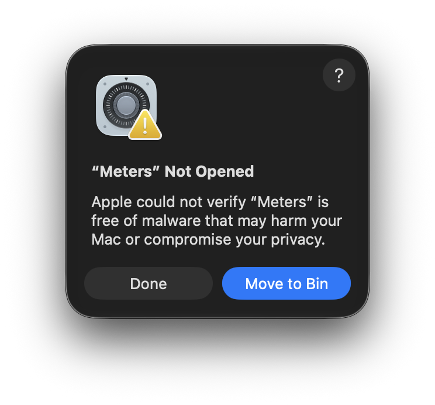
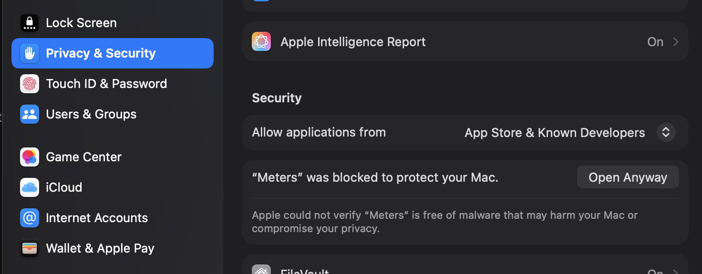

<p align="center">
  
</p>

<h1 align="center">Meters</h1>

A tiny macOS menu bar app that shows your Mac's CPU, memory and GPU usage at a glance.

```
CPU 12%  |  RAM 48%  |  GPU 8%
```

Prefer something more compact? Flip on **Icons in menu bar** and the labels become the same SF Symbols the popover uses.

Click it for a native popover with live graphs. No Dock icon, no windows, almost no CPU cost.

<p align="center">
  
  
</p>

## Why I built this

I run LLMs locally on my Mac, and I wanted to see what they were doing to it: how hard the CPU and GPU were working, and how much memory the model was taking up. Activity Monitor felt like too much to keep open, and most menu bar monitors show far more than I need. So I made Meters to be minimal: three numbers in the menu bar, a glance-able graph when you click, and nothing else.

## Features

- Live CPU, memory and GPU usage in the menu bar
- CPU, RAM and GPU percentages turn amber at 60% usage and red at 80%
- Text or icon labels in the menu bar, switchable from the popover
- Native look: system fonts, SF Symbols, light and dark mode
- Popover with a 2-minute history graph for each metric
- Launch at login
- One Swift file, no dependencies

### Usage colors

Each CPU, RAM and GPU percentage in the menu bar changes color independently:

| Usage | Percentage color |
|---|---|
| Below 60% | Default text color |
| 60% to below 80% | Amber |
| 80% and above | Red |

These colors apply with both text and icon labels. Only the percentages change color; labels, icons and separators keep their usual appearance. An unavailable GPU reading (`--%`) keeps the default text color.

## Install

1. Download `Meters.zip` from the [latest release](https://github.com/yashwant-das/meters/releases/latest) and unzip it.
2. Drag **Meters** into your Applications folder.
3. Open it. The first time, macOS stops it with a **"Meters" Not Opened** message. Click **Done** (not Move to Bin).

   

4. Open **System Settings → Privacy & Security** and scroll down to **Security**. You'll see "Meters" was blocked to protect your Mac. Click **Open Anyway**, confirm with your password or Touch ID, and Meters starts.

   

You only need to do this once. After that, Meters opens normally, including at login.

### Why macOS shows this warning

Apple asks developers to pay for a developer account ($99 a year) so that their apps can be signed with a verified identity and *notarized*: uploaded to Apple, scanned for malware and approved. macOS trusts notarized apps automatically.

Meters is a free side project and isn't notarized, so macOS can't tell who made it and blocks it the first time, just to be safe. This doesn't mean anything is wrong with the app. **Open Anyway** is Apple's own way to say you trust it.

If you'd rather not take my word for it, the code is all in this repo. The release itself is built by [GitHub Actions](.github/workflows/release.yml) straight from this source, and you can build it yourself too (below).

## Requirements

- macOS 14 Sonoma or later
- Xcode 26 or later to build

## Build from source

1. Clone the repo and open `meters.xcodeproj` in Xcode.
2. In Signing & Capabilities, select your team (or "Sign to Run Locally").
3. Press Run (⌘R). Xcode builds `Meters.app` and it appears in your menu bar.

App Sandbox is turned off on purpose: the GPU numbers come from IOKit, which the sandbox can block.

## How it works

| Metric | Source |
|---|---|
| CPU | `host_statistics` tick counts, compared between samples |
| Memory | `host_statistics64`, counting app + wired + compressed memory (the same idea as Activity Monitor's "Memory Used") |
| GPU | IOKit `IOAccelerator` `PerformanceStatistics` |

The GPU values come from an undocumented IOKit interface. Key names differ between hardware and macOS versions, so on some machines the GPU may show `--%`. If that happens on yours, please open an issue with your Mac model and macOS version.

## Contributing

Issues and pull requests are welcome. Ideas that would be nice to have:

- Per-core CPU view
- Network and disk activity
- Choose which metrics appear in the menu bar
- Custom refresh interval

## License

[MIT](LICENSE)
