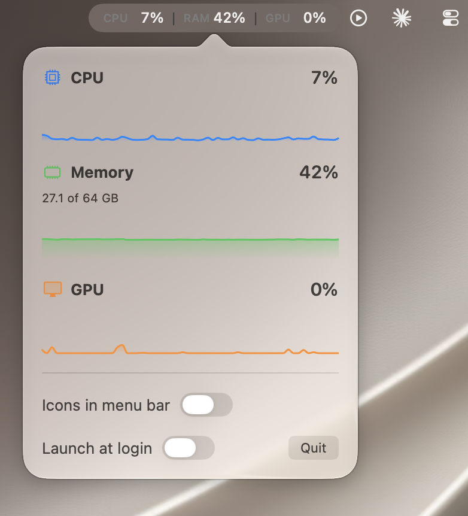
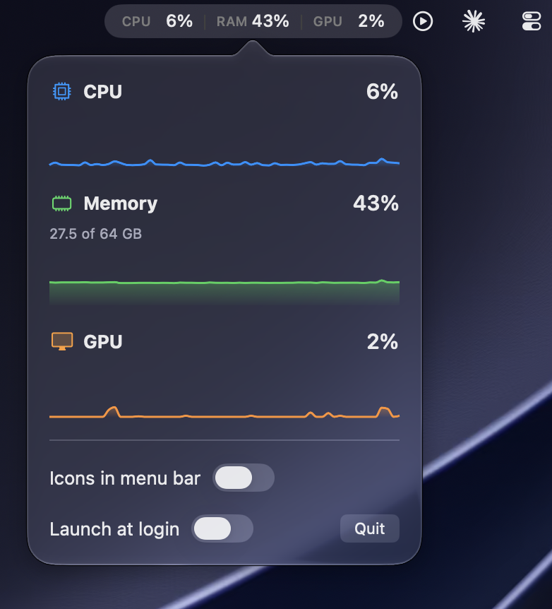

<p align="center">
  
</p>

<h1 align="center">Meters</h1>

A tiny macOS menu bar app that shows your Mac's CPU, memory and GPU usage at a glance.

```
CPU 12%   GPU 8%   RAM 48%
```

Open **Settings…** in the popover to choose a menu bar style: **Refined text**, **Compact symbols**, or **Text with micro meters**. Choose the popover layout independently: **Grouped system panel**, **Compact menu extra**, or **Activity Monitor miniature**. All nine combinations are supported, and both choices are remembered between launches.

Click it for a native popover with live graphs. Monitoring lives in the menu bar, with no Dock icon and a separate settings window.

<p align="center">
  
  
</p>

## Why I built this

I run LLMs locally on my Mac, and I wanted to see what they were doing to it: how hard the CPU and GPU were working, and how much memory the model was taking up. Activity Monitor felt like too much to keep open, and most menu bar monitors show far more than I need. So I made Meters to be minimal: three numbers in the menu bar, a glance-able graph when you click, and nothing else.

## Features

- Live CPU, memory and GPU usage in the menu bar
- CPU, RAM and GPU percentages turn amber at 60% usage and red at 80%
- Three independent menu bar styles: refined text, compact SF Symbols, or text with tiny usage meters
- Three popover layouts: grouped sections, compact expandable details, or an Activity Monitor-style overview
- Native appearance settings with a live menu bar preview; changes apply immediately
- Native look: system fonts, SF Symbols, light and dark mode
- Separate efficiency/performance core readings and overlaid CPU history
- Thermal state, 1/5/15-minute load averages and system uptime
- GPU utilization and GPU memory usage with overlaid history
- Stacked memory bar with wired, active, compressed and free memory
- Up to 2 minutes of CPU and GPU history, sampled every 2 seconds
- Timestamped charts keep the history window accurate if sampling is delayed
- Launch at login
- Native SwiftUI, no dependencies

### Usage colors

Each CPU, RAM and GPU percentage in the menu bar changes color independently:

| Usage | Percentage color |
|---|---|
| Below 60% | Default text color |
| 60% to below 80% | Amber |
| 80% and above | Red |

These colors apply with both text and icon labels. Labels and icons keep their usual appearance. An unavailable GPU reading (`--%`) keeps the default text color.

Micro-meter fills also use the usage colors. All styles reserve space for three-digit readings, so `0%`, `100%` and unavailable readings keep the menu bar steady. Existing users who enabled icon labels keep the compact-symbol style when updating.

Graph colors identify series independently of the usage thresholds above. CPU efficiency is teal (solid), performance is blue (dashed), and an unsplit CPU total is blue (solid). GPU utilization is blue (solid); GPU memory is purple (dashed). Legends repeat the line patterns so overlapping series can be distinguished without color alone. Memory categories use blue for wired, teal for active, purple for compressed, and neutral gray for available. These category colors do not indicate memory pressure. The palette has separate light and dark variants; orange/red remain status indicators for menu bar usage and thermal state.

### Appearance settings

Click **Settings…** at the bottom of any popover, or press **⌘,** while Meters is active. The popover layout and menu bar style are separate choices. In the compact layout, expand **Memory breakdown** or **System details** for the full statistics; the panel scrolls when needed. **Launch at login** lives in the same settings window and reports if macOS needs approval in Login Items.

The app uses macOS system typography, SF Symbols, native controls and popover material in both light and dark mode. The editable design reference is [Meters in Figma](https://www.figma.com/design/ZaNr6Mp1dDnydetqmW7cSN?node-id=8-4).

## Install

1. Download `Meters.zip` from the [latest release](https://github.com/yashwant-das/meters/releases/latest) and unzip it.
2. Drag **Meters** into your Applications folder.
3. Open it. The first time, macOS stops it with a **"Meters" Not Opened** message. Click **Done** (not Move to Bin).

   

4. Open **System Settings → Privacy & Security** and scroll down to **Security**. You'll see "Meters" was blocked to protect your Mac. Click **Open Anyway**, confirm with your password or Touch ID, and Meters starts.

   

You only need to do this once. After that, Meters opens normally, including at login.

### Why macOS shows this warning

Apple asks developers to pay for a developer account ($99 a year) so that their apps can be signed with a verified identity and *notarized*: uploaded to Apple, scanned for malware and approved. macOS trusts notarized apps automatically.

Meters is a free side project and isn't notarized, so macOS can't tell who made it and blocks it the first time, just to be safe. This doesn't mean anything is wrong with the app. **Open Anyway** is Apple's own way to say you trust it.

If you'd rather not take my word for it, the code is all in this repo. The release itself is built by [GitHub Actions](.github/workflows/release.yml) straight from this source, and you can build it yourself too (below).

## Requirements

- macOS 14 Sonoma or later
- Xcode 26 or later to build

## Build from source

1. Clone the repo and open `meters.xcodeproj` in Xcode.
2. In Signing & Capabilities, select your team (or "Sign to Run Locally").
3. Press Run (⌘R). Xcode builds `Meters.app` and it appears in your menu bar.

App Sandbox is turned off on purpose: the GPU numbers come from IOKit, which the sandbox can block.

### Xcode UI previews

Open `meters/UIPreviews.swift`, then choose **Editor → Canvas** (⌥⌘↩) and click **Resume** if needed. The Canvas includes each popover layout, all three real AppKit menu bar styles, and settings in light and dark appearance. Popovers use live readings from your Mac, so history fills as samples arrive. Preview preferences are separate from the app's saved settings. Settings previews are visual only, to avoid changing launch-at-login from the Canvas.

## How it works

| Metric | Source |
|---|---|
| CPU | `host_processor_info` per-core tick deltas, grouped by logical CPU IDs and E/P cluster types from IOKit |
| Memory | `host_statistics64`, counting app + wired + compressed memory (the same idea as Activity Monitor's "Memory Used") |
| GPU | IOKit `IOAccelerator` `PerformanceStatistics`, including in-use system memory |
| System | `ProcessInfo` thermal state and uptime; `getloadavg` for load averages |

The GPU values come from an undocumented IOKit interface. Key names differ between hardware and macOS versions, so on some machines the GPU may show `--%`. If that happens on yours, please open an issue with your Mac model and macOS version.

The memory breakdown preserves the existing Activity Monitor-style total: **Active** is internal memory minus purgeable memory, **Wired** is resident wired memory, and **Compressed** is the compressor’s physical footprint. **Available** is total minus used, including reclaimable cache; it is not just the kernel’s free-page count. GPU memory uses the driver’s in-use memory counter, not allocated memory, and its history shows a percentage of total system memory. GPU memory overlaps system memory on Apple Silicon.

E/P readings show `N/A` when core topology is unavailable; aggregate CPU usage still works. Missing GPU usage or memory counters also show `N/A`. History starts with real samples rather than padded zero readings. The panel scrolls on smaller displays.

### Check metric calculations

```sh
swiftc meters/MonitoringData.swift tests/MonitoringDataTests.swift -o /tmp/meters-data-tests
/tmp/meters-data-tests
```

Check preference migration, all nine style combinations, safe formatting and stable rendered menu widths:

```sh
swiftc meters/AppearancePreferences.swift meters/MenuBarRenderer.swift tests/AppearanceTests.swift -o /tmp/meters-appearance-tests
/tmp/meters-appearance-tests
```

## Roadmap

See the [roadmap](ROADMAP.md) for planned features, including **live oMLX token tracking** and a later **Ollama integration**, plus network/disk activity, menu bar metric selection, and refresh controls.

## Contributing

Issues and pull requests are welcome.

## License

[MIT](LICENSE)
