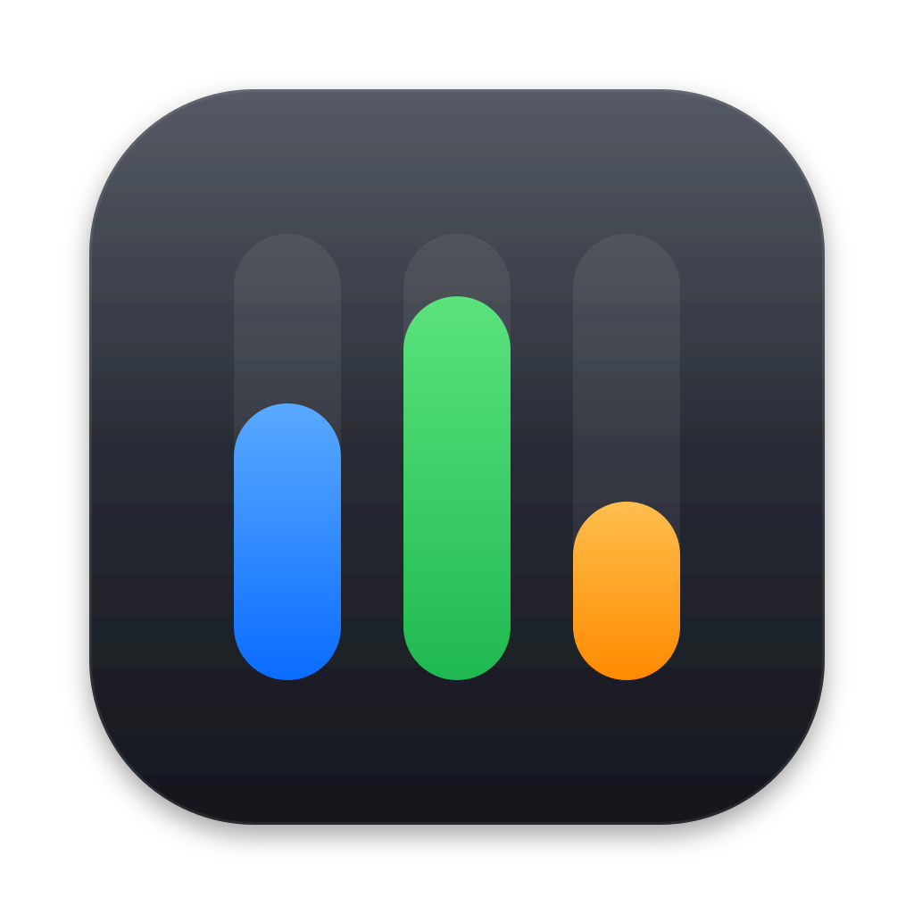
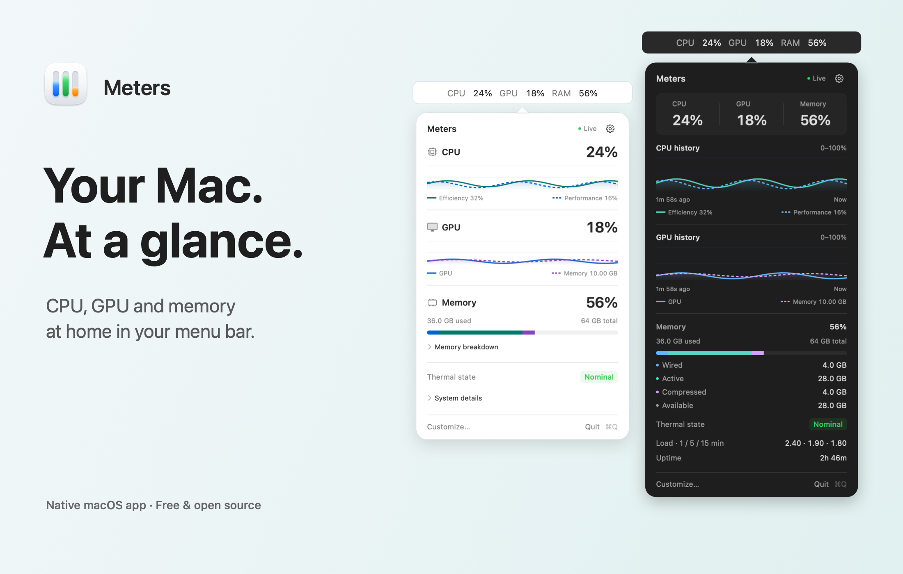
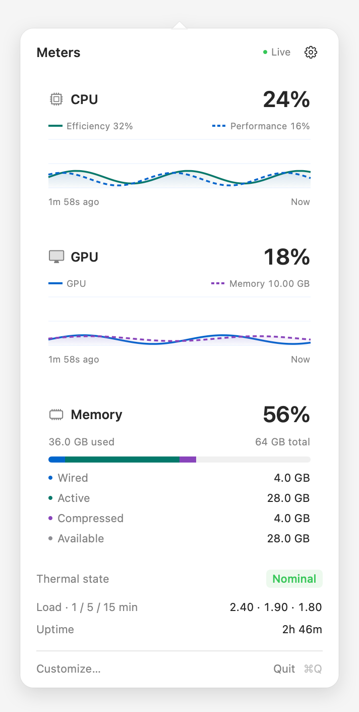
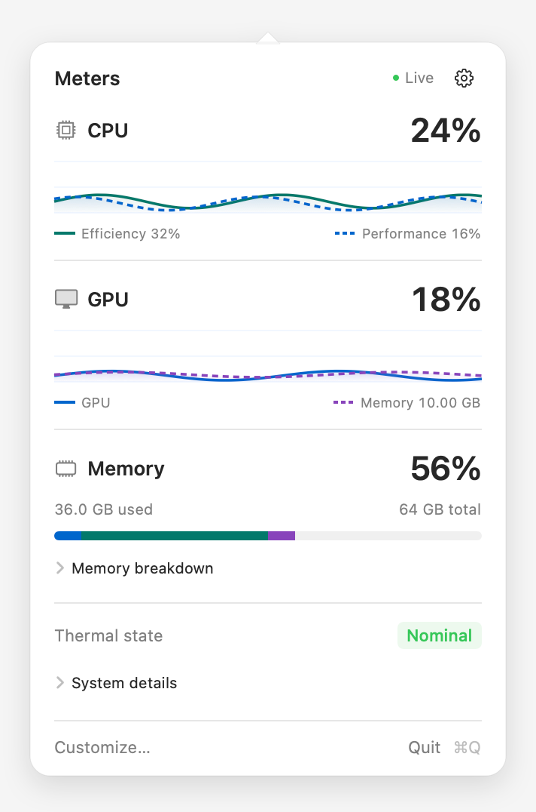
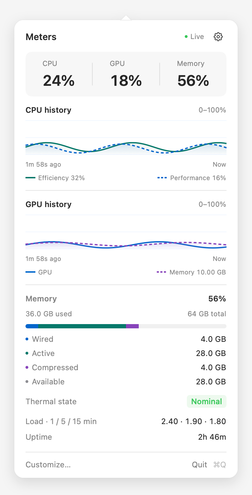
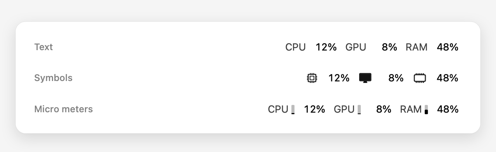
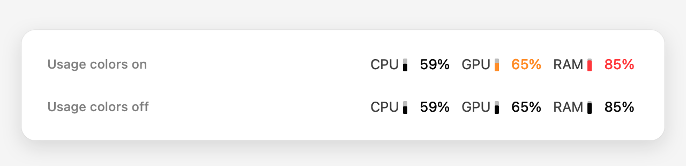
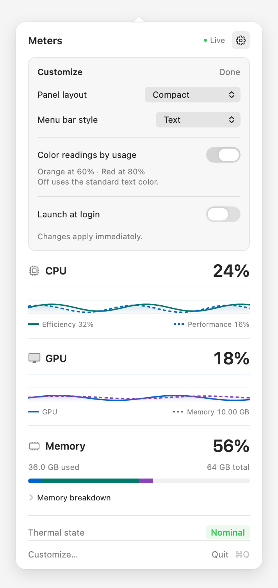
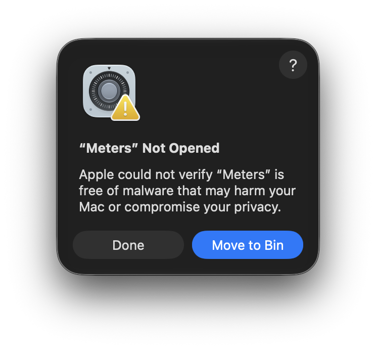
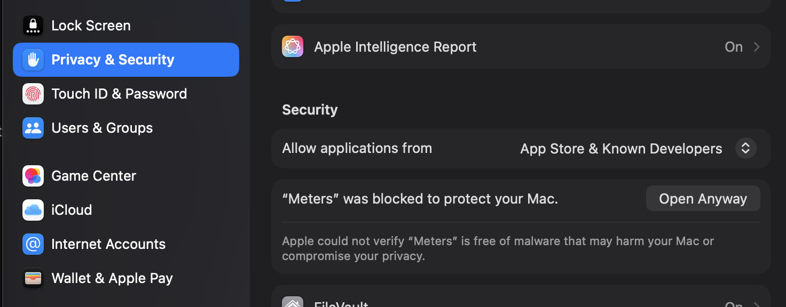

<p align="center">
  
</p>

<h1 align="center">Meters</h1>
<p align="center"><strong>Your Mac. At a glance.</strong></p>
<p align="center">CPU, GPU and memory, right in your menu bar.<br>A free, native macOS app built with SwiftUI and AppKit.</p>

<p align="center">
  <a href="https://github.com/yashwant-das/meters/releases/latest"><strong>Download for macOS</strong></a>
  &nbsp; · &nbsp;
  <a href="#pick-your-view">Explore the UI</a>
  &nbsp; · &nbsp;
  <a href="#build-from-source">Build from source</a>
  &nbsp; · &nbsp;
  <a href="ROADMAP.md">Roadmap</a>
</p>

<p align="center">
  
</p>

## See what your Mac is doing

Keep an eye on your Mac while compiling, rendering, or running local models. Meters puts live CPU, GPU and RAM percentages in the menu bar. Click once for a closer look at core activity, memory usage, thermals, and up to two minutes of history.

- **Useful at a glance.** Choose text, SF Symbols, or tiny usage meters. Readings keep a stable width as values change.
- **Detail when you want it.** Compare efficiency and performance cores, GPU activity and memory, or expand the full memory breakdown.
- **Fits your Mac.** System typography, native controls, and light or dark appearance that follows macOS. The panel fits its content and scrolls on shorter screens.
- **Runs locally.** Monitoring reads macOS system counters. No account is required, and the app stays out of the Dock.

## Pick your view

Choose how much detail you want in the popover. Pair any layout with any menu bar style: all nine combinations work independently.

<table>
  <tr>
    <th width="33%">Grouped</th>
    <th width="33%">Compact</th>
    <th width="33%">Activity Monitor</th>
  </tr>
  <tr>
    <td align="center" valign="top"><picture><source media="(prefers-color-scheme: dark)" srcset="docs/images/grouped-dark.png"></picture></td>
    <td align="center" valign="top"><picture><source media="(prefers-color-scheme: dark)" srcset="docs/images/compact-dark.png"></picture></td>
    <td align="center" valign="top"><picture><source media="(prefers-color-scheme: dark)" srcset="docs/images/activity-dark.png"></picture></td>
  </tr>
  <tr>
    <td valign="top">Every statistic visible in distinct sections.</td>
    <td valign="top">A smaller panel with details you can expand.</td>
    <td valign="top">Headline readings followed by a fuller history view.</td>
  </tr>
</table>

Images above adapt to your GitHub appearance. [Browse the full gallery](docs/GALLERY.md) for both themes, expanded details, customization, and unavailable readings.

## Give your menu bar a style

Keep familiar text labels, switch to monochrome SF Symbols, or add micro meters alongside each percentage. The order is always **CPU → GPU → RAM**, with the macOS menu bar typeface.

<p align="center">
  <picture>
    <source media="(prefers-color-scheme: dark)" srcset="docs/images/menu-styles-dark.png">
    
  </picture>
</p>

Usage colors are optional. With them on, each percentage and micro-meter fill turns orange at 60% and red at 80%. Switch them off for the standard macOS text color. Labels and symbols keep their usual appearance.

<details>
<summary><strong>Compare usage colors on and off</strong></summary>
<br>
<picture>
  <source media="(prefers-color-scheme: dark)" srcset="docs/images/usage-colors-dark.png">
  
</picture>

| Usage | With usage colors on |
|---|---|
| Below 60% | Standard text color |
| 60% to below 80% | Orange |
| 80% and above | Red |

Unavailable readings use `--%` and keep the standard text color. Usage thresholds describe utilization, not memory pressure.

</details>

## Make it yours, in place

Open the header gear, choose **Customize…**, or press **⌘,**. Settings unfold above your live dashboard, so you can see each change as you make it. Monitoring history keeps running.

<p align="center">
  <picture>
    <source media="(prefers-color-scheme: dark)" srcset="docs/images/customize-dark.png">
    
  </picture>
</p>

Choose the panel layout and menu bar style separately, toggle usage colors, and enable launch at login. Your choices are remembered. **Done** collapses the controls; the next time you open Meters, it starts with your readings in view. If Customize is scrolled out of sight, **⌘,** brings it back.

<sub>Native UI renders use illustrative readings. Popover material varies with the desktop behind it.</sub>

## Install

**Requires macOS 14 Sonoma or later.**

1. Download `Meters.zip` from the [latest release](https://github.com/yashwant-das/meters/releases/latest) and unzip it.
2. Drag **Meters** into Applications.
3. Open the app and look for the readings in your menu bar.

The release build is signed ad hoc and is not notarized. macOS may require you to allow it in Privacy & Security on first launch.

<details>
<summary><strong>First launch: “Meters Not Opened”</strong></summary>

1. Click **Done** in the macOS warning.

   

2. Open **System Settings → Privacy & Security**. Under Security, find the message about Meters and choose **Open Anyway**.

   

3. Confirm with your password or Touch ID, then open Meters.

This is a first-launch step. You can enable **Launch at login** in Customize afterward. If macOS needs Login Items approval, Meters shows the next step there.

The [release workflow](.github/workflows/release.yml) builds from the repository source. You can also build it yourself below.

</details>

## A closer look at the readings

| In Meters | What you can see |
|---|---|
| CPU | Total utilization, separate efficiency/performance core readings when available, and overlaid history |
| GPU | Utilization and in-use GPU memory, with both series in the history chart |
| Memory | Used/total memory, plus wired, active, compressed, and available categories |
| System | Thermal state, load averages over 1/5/15 minutes, and uptime |
| History | Up to two minutes of timestamped samples, collected every two seconds |

<details>
<summary><strong>How to read the graph colors</strong></summary>

| Series | Color and line |
|---|---|
| CPU efficiency | Teal, solid |
| CPU performance | Blue, dashed |
| CPU total, when the core split is unavailable | Blue, solid |
| GPU utilization | Blue, solid |
| GPU memory | Purple, dashed |

Legends repeat the line patterns to help distinguish overlapping series. The palette has separate light and dark variants. Memory categories use blue for wired, teal for active, purple for compressed, and neutral gray for available.

Graph colors identify series; they do not indicate severity. The menu bar's optional orange/red thresholds and macOS thermal-state badge communicate status separately.

</details>

<details>
<summary><strong>Data sources and hardware limitations</strong></summary>

| Metric | Source |
|---|---|
| CPU | `host_processor_info` per-core tick deltas, grouped by logical CPU IDs and E/P cluster types from IOKit |
| Memory | `host_statistics64`, counting app + wired + compressed memory |
| GPU | IOKit `IOAccelerator` `PerformanceStatistics`, including in-use system memory |
| System | `ProcessInfo` thermal state and uptime; `getloadavg` for load averages |

GPU counters come from an undocumented IOKit interface. Availability and key names vary by hardware and macOS version. Unsupported counters show `N/A` in the popover and `--%` in the menu bar. A missing core split also shows `N/A`, while aggregate CPU usage continues. [See the unavailable-data UI](docs/GALLERY.md#unavailable-readings).

The memory total follows the Activity Monitor-style “Memory Used” calculation. **Active** is internal memory minus purgeable memory; **Wired** is resident wired memory; **Compressed** is the compressor’s physical footprint. **Available** is total minus used, including reclaimable cache.

GPU memory overlaps system memory on Apple Silicon. It uses the driver's in-use counter, and its graph shows a share of total system memory, not dedicated VRAM. Core-group percentages are averaged within each group; the CPU total is weighted across all cores.

History starts with real samples, without padding in zero readings. Timestamps keep the chart accurate if sampling is delayed. The [source](meters) is available to inspect these calculations.

</details>

## Build from source

Use **Xcode 26 or later**.

1. Clone this repository and open `meters.xcodeproj`.
2. In **Signing & Capabilities**, select your team or **Sign to Run Locally**.
3. Press **⌘R**. Meters appears in your menu bar.

App Sandbox is disabled because GPU monitoring uses IOKit. The app has no external package dependencies.

<details>
<summary><strong>Xcode Canvas previews</strong></summary>

Open `meters/UIPreviews.swift`, choose **Editor → Canvas** (⌥⌘↩), and click **Resume** if needed. Previews include all three layouts, all three real AppKit menu bar styles, and inline Customize in light and dark appearance.

Popover previews use live readings, so history fills as samples arrive. Preview preferences are isolated from the app's saved settings. Customize previews are visual only to avoid changing launch at login from the Canvas.

</details>

<details>
<summary><strong>Run the checks</strong></summary>

Metric calculations:

```sh
swiftc meters/MonitoringData.swift tests/MonitoringDataTests.swift -o /tmp/meters-data-tests
/tmp/meters-data-tests
```

Preferences, all nine combinations, formatting, menu widths, and usage colors:

```sh
swiftc meters/AppearancePreferences.swift meters/MenuBarRenderer.swift tests/AppearanceTests.swift -o /tmp/meters-appearance-tests
/tmp/meters-appearance-tests
```

Content sizing and Customize presentation:

```sh
swiftc meters/PopoverPresentation.swift tests/PopoverPresentationTests.swift -o /tmp/meters-popover-tests
/tmp/meters-popover-tests
```

To refresh the documentation images, see the [gallery capture notes](docs/GALLERY.md#refreshing-the-images).

</details>

## Why I built Meters

I run LLMs locally on my Mac and wanted to see how hard the CPU and GPU were working, and how much memory the model was using. Activity Monitor felt like too much to keep open. I made Meters so those readings could stay in the menu bar, with the detail a click away.

## What’s next

The [roadmap](ROADMAP.md) tracks planned work, including oMLX token tracking first, an Ollama integration later, and network/disk activity. Token tracking is not implemented yet.

Issues and pull requests are welcome. Include your Mac model and macOS version when reporting missing counters or a UI issue.

<p align="center"><a href="https://github.com/yashwant-das/meters/releases/latest">Download Meters</a> &nbsp; · &nbsp; <a href="https://github.com/yashwant-das/meters/issues">Report an issue</a> &nbsp; · &nbsp; <a href="LICENSE">MIT license</a></p>
