# Meters UI gallery

[← Back to Meters](../README.md)

Native SwiftUI and AppKit views from the current source, rendered with illustrative data. These images preview the next release. Rounded framing and hero composition are documentation artwork; popover materials depend on the desktop behind them.

The three panel layouts and three menu bar styles combine independently, giving nine configurations. Both macOS appearances are shown below. Click an image to inspect it at full size.

## Grouped

All statistics visible in separate CPU, GPU, and memory cards.

<table>
<tr><th>Light</th><th>Dark</th></tr>
<tr>
<td valign="top"><a href="images/grouped-light.png">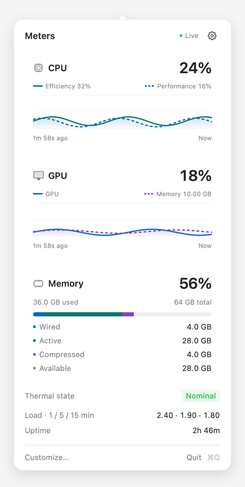</a></td>
<td valign="top"><a href="images/grouped-dark.png">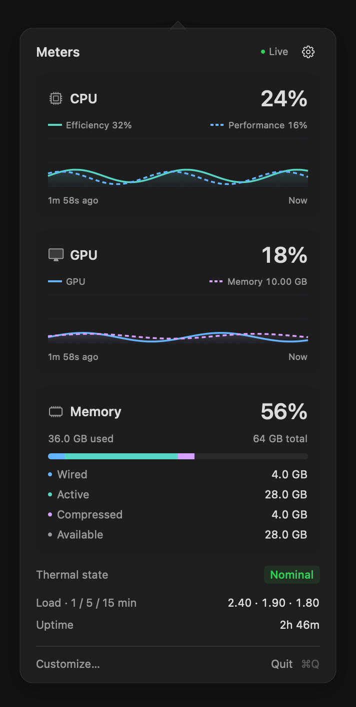</a></td>
</tr>
</table>

## Compact

A shorter overview with memory and system details collapsed.

<table>
<tr><th>Light</th><th>Dark</th></tr>
<tr>
<td valign="top"><a href="images/compact-light.png">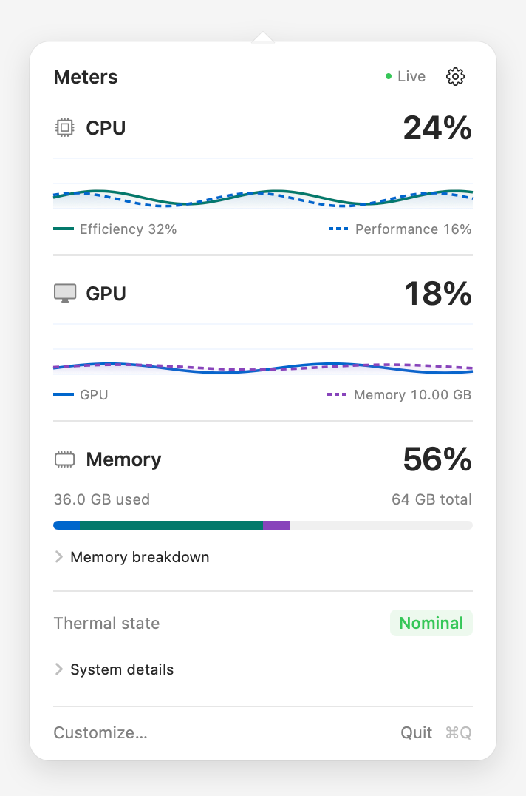</a></td>
<td valign="top"><a href="images/compact-dark.png">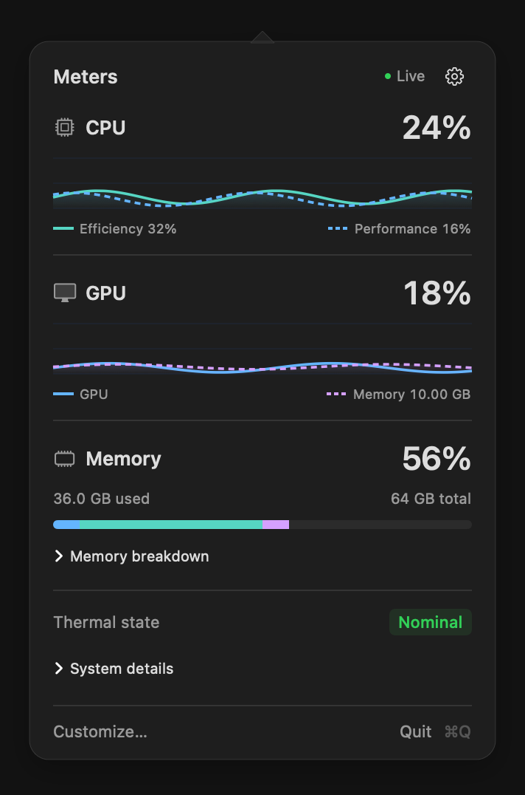</a></td>
</tr>
</table>

## Activity Monitor

Overview percentages above detailed history charts.

<table>
<tr><th>Light</th><th>Dark</th></tr>
<tr>
<td valign="top"><a href="images/activity-light.png">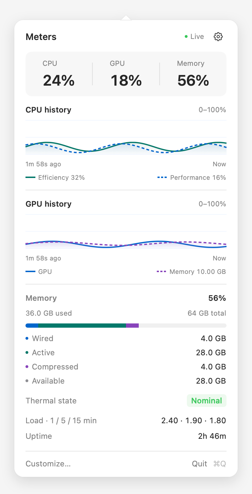</a></td>
<td valign="top"><a href="images/activity-dark.png">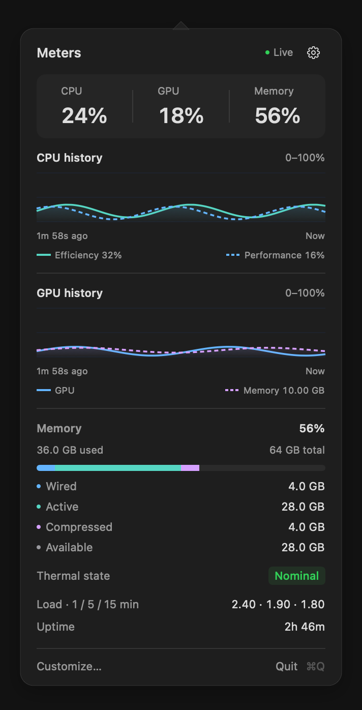</a></td>
</tr>
</table>

## Expanded compact details

Memory categories and system details expanded. The panel grows until it reaches the screen cap.

<table>
<tr><th>Light</th><th>Dark</th></tr>
<tr>
<td valign="top"><a href="images/details-light.png">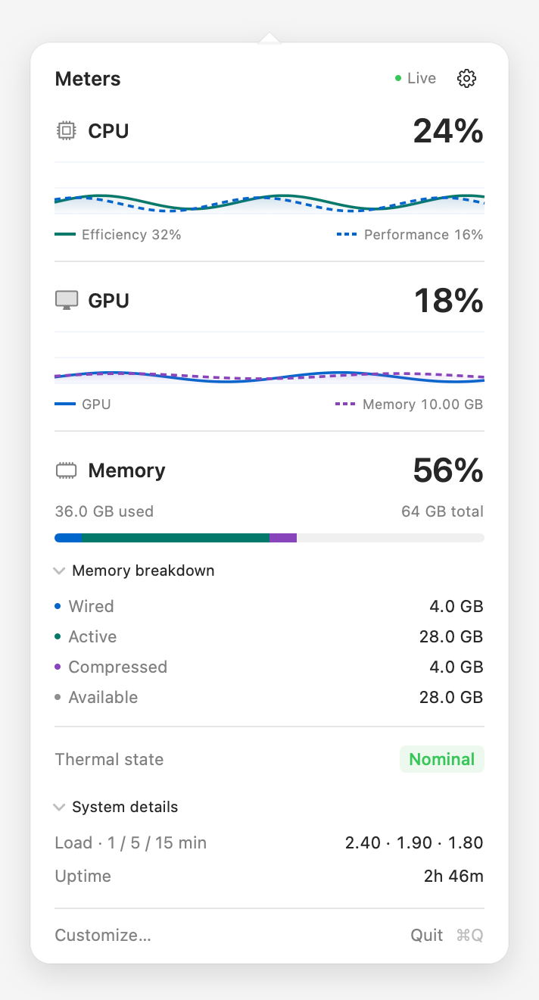</a></td>
<td valign="top"><a href="images/details-dark.png">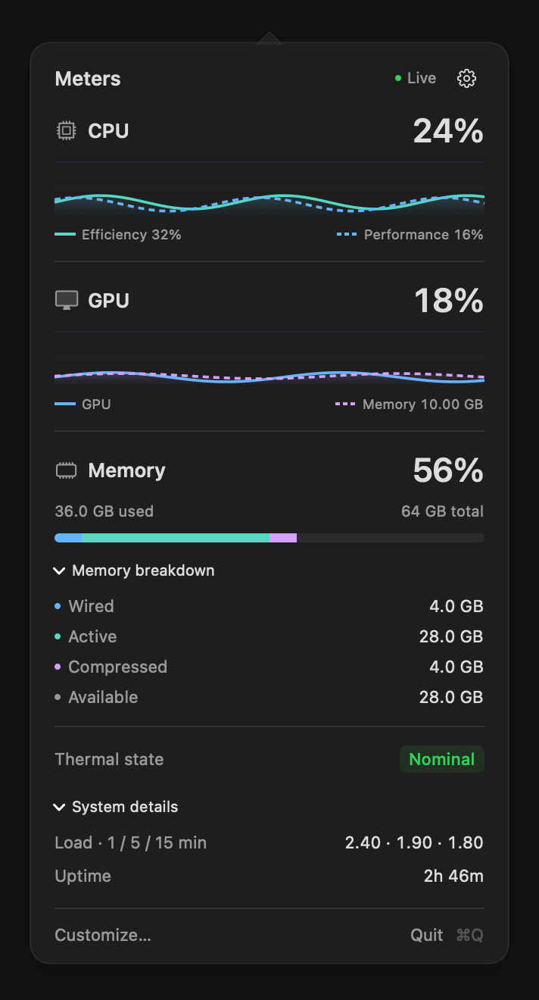</a></td>
</tr>
</table>

## Inline Customize

The shared controls open above the live dashboard. Layout and menu style are independent; colors and launch at login are separate switches. At the height cap, the middle scrolls while the header/footer remain accessible.

<table>
<tr><th>Light</th><th>Dark</th></tr>
<tr>
<td valign="top"><a href="images/customize-light.png">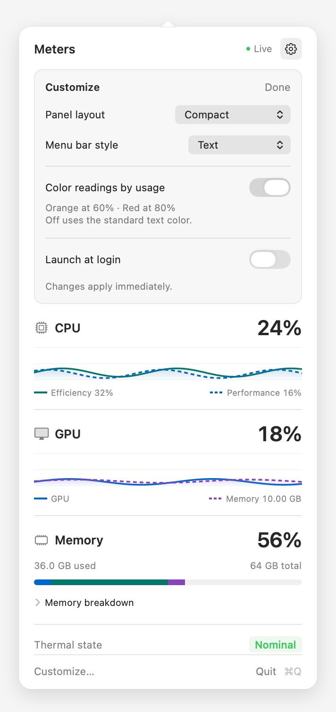</a></td>
<td valign="top"><a href="images/customize-dark.png">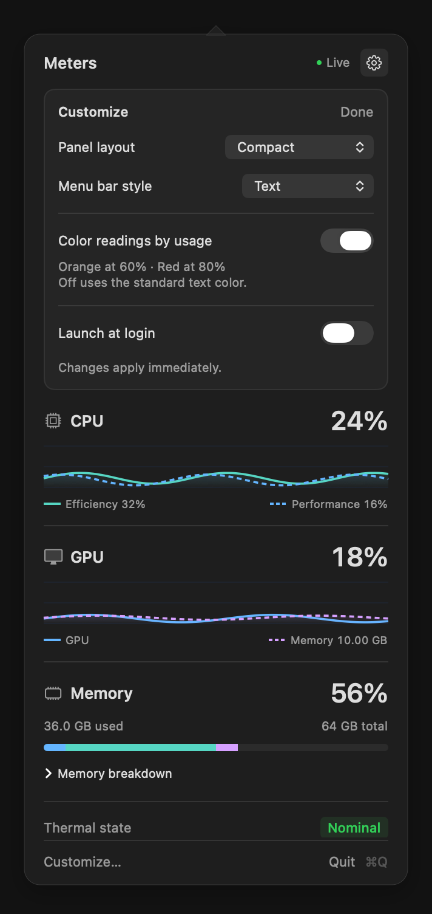</a></td>
</tr>
</table>

## Menu bar styles

The real AppKit renderer: Text, Symbols, and Micro meters. CPU → GPU → RAM order and the native menu bar font are preserved.

<table>
<tr><th>Light</th><th>Dark</th></tr>
<tr>
<td valign="top"><a href="images/menu-styles-light.png">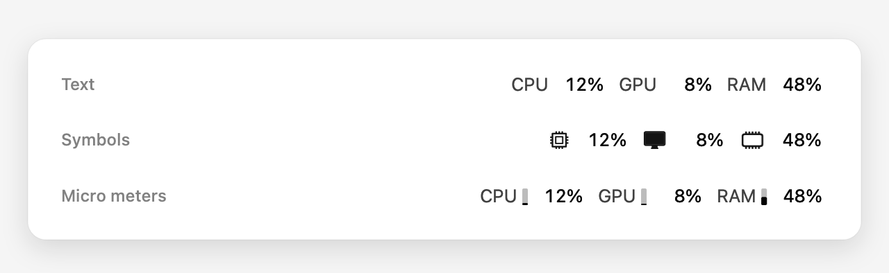</a></td>
<td valign="top"><a href="images/menu-styles-dark.png">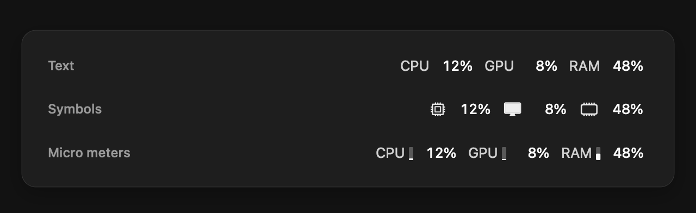</a></td>
</tr>
</table>

## Optional usage colors

CPU 59% stays neutral, GPU 65% turns orange, and RAM 85% turns red. With usage colors disabled, percentages and meter fills use the standard text color.

<table>
<tr><th>Light</th><th>Dark</th></tr>
<tr>
<td valign="top"><a href="images/usage-colors-light.png">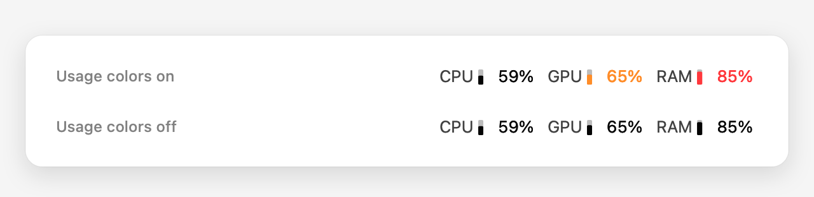</a></td>
<td valign="top"><a href="images/usage-colors-dark.png">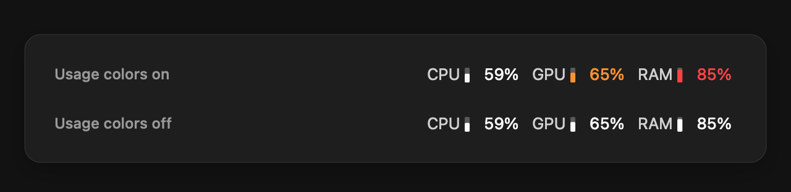</a></td>
</tr>
</table>

## Unavailable readings

Missing GPU counters show N/A with an empty history. When core topology is unavailable, CPU history falls back to the aggregate reading.

<table>
<tr><th>Light</th><th>Dark</th></tr>
<tr>
<td valign="top"><a href="images/unavailable-light.png">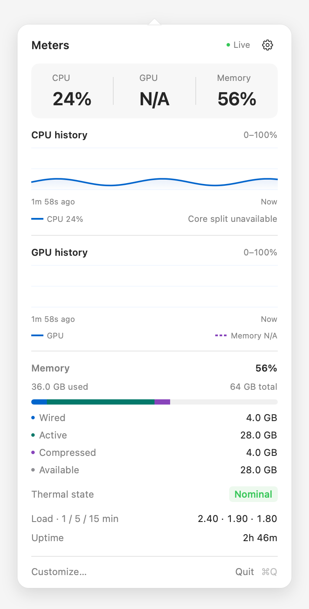</a></td>
<td valign="top"><a href="images/unavailable-dark.png">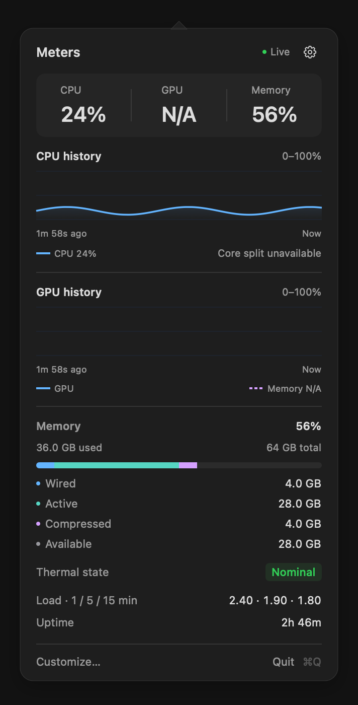</a></td>
</tr>
</table>

## Refreshing the images

Build the current app in Release configuration so the color assets match its UI:

```sh
xcodebuild -project meters.xcodeproj -scheme meters -configuration Release \
  -derivedDataPath /tmp/meters-inline-build CODE_SIGNING_ALLOWED=NO build
bash scripts/capture-documentation.sh
```

Set `METERS_DOCS_DERIVED_DATA` if your Release build uses another derived-data directory. Run the script on macOS with Xcode installed. It compiles the production views with a documentation-only monitor fixture, then writes Retina PNGs to `docs/images`. It does not run the real monitor, change the installed app's appearance preferences, or register launch at login.

Expanded-detail captures use a temporary copy of `StatsView.swift` with its two disclosure defaults set to expanded. Product source and layout remain unchanged. A separate temporary app bundle supplies the compiled color assets. Capture preferences use isolated suites and are cleared after rendering.

Review the regenerated images and the README in both light and dark appearance before committing. Keep the next-release notice until these UI changes are published, then remove it from both documents. Figma synchronization is separate and remains deferred until after release and user approval.
